# ECHOFORM · 声音建筑师

`STATUS · OPEN SOURCE`　`WEBGL2`　`REACT 19`　`NO BACKEND`　`LOCAL AUDIO ONLY`

**把一段声音，变成一座可以走进去的建筑。**

**制作模型：DeepSeek V4.1 Flash 1017**（`DeepSeek-V4.1-Flash-1017`）。初版程序化建筑建模与核心代码由该模型生成，后续完成工程优化、测试与开源部署。

[在线体验](https://kang340.github.io/echoform/) · [GitHub 仓库](https://github.com/kang340/echoform) · [贡献指南](CONTRIBUTING.md) · [优化记录](docs/OPTIMIZATION.md)

ECHOFORM 是一个在浏览器里实时生成建筑的实验性产品。你说一句话、唱一个音、上传一段录音，系统会读取它的音高、响度、频谱、节奏、停顿与音色，把这些参数翻译成拱券、侧殿、柱列、旋梯、悬浮结构与光。建筑不是预设模型的换皮，也不是频谱条的旋转版本，而是从声音的结构里长出来的空间。

> A voice becomes a nave. A pause becomes a hall. A rhythm becomes a stair.
>
> 声音成为中殿，停顿成为空厅，节奏成为旋梯。

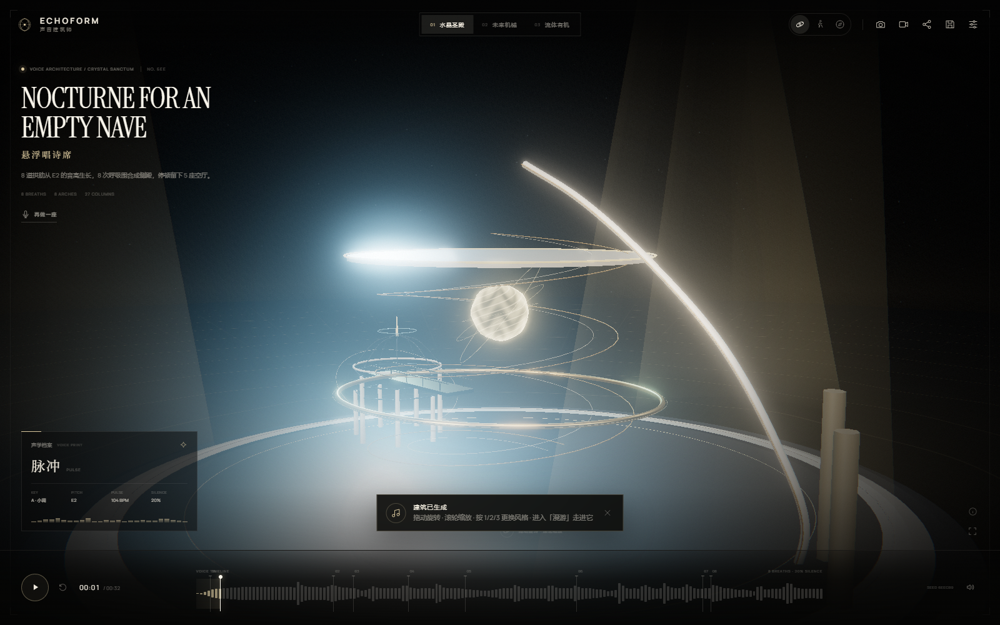

<details>
<summary><strong>EN · Project at a glance</strong></summary>

**ECHOFORM** turns a voice into an explorable generative building. It analyses pitch, loudness, spectrum, rhythm, pauses and timbre, then derives a deterministic `DesignSpec`: arches, side halls, columns, rings, stairs, shards, particles, materials, lights and a timeline.

**Built with DeepSeek V4.1 Flash 1017** (`DeepSeek-V4.1-Flash-1017`): the initial procedural architecture modeling and core code were generated with this model, followed by engineering improvements, testing and open-source deployment.

- **Low frequency → thick arches / heavy base.**
- **High frequency → slender columns / suspended shards.**
- **Loudness → scale. Rhythm → modules and stairs.**
- **Pauses → empty halls. Phrases → side chambers.**
- **Timbre → crystal, metal or membrane.**

Three complete art directions: **Crystal Sanctum**, **Neo Machine**, **Fluid Organic**. Orbit, first-person roam and a guided camera. Export a 2560×1440 poster, H.264 MP4, parameter JSON or a reproducible link. Audio is processed locally and never uploaded.

Stack: React 19 · TypeScript · Three.js · Web Audio · Vite. No backend, no third-party 3D/HDRI/audio assets. See [RUNBOOK](docs/RUNBOOK.md), [PERFORMANCE](docs/PERFORMANCE.md), [QA](docs/QA.md) and [ASSETS & LICENSES](docs/ASSETS_LICENSES.md).

```bash
npm install && npm run dev   # http://127.0.0.1:5178/
```

</details>

---

## 1. 它是什么

- **声音 → 建筑**：一段 7 秒的人声，会得到一个 7 秒内逐步“浇筑”出来的空间；32 秒的示例声景，会得到 8 个乐句、8 座侧殿，5 次真正的停顿留下 5 座空厅。
- **三种艺术方向**：水晶圣殿 `CRYSTAL SANCTUM`、未来机械 `NEO MACHINE`、流体有机 `FLUID ORGANIC`。同一段声音在三种方向下共享指纹与结构逻辑，但材料、光、构件语言完全不同。
- **可漫游**：轨道环绕、第一人称漫游（WASD / QE / 手机摇杆）、导演式导览镜头。你可以在拱下穿过，在柱林里停下，抬头看光。
- **可导出**：16:9 海报 PNG、H.264 MP4 影像、参数 JSON、可复现的分享链接、本地展厅存档。
- **确定性**：同一段音频 + 同一种风格，永远生成同一座建筑。指纹、几何、材质、粒子都在设计层确定，不依赖随机帧。

### 三种风格

| 水晶圣殿 | 未来机械 | 流体有机 |
| --- | --- | --- |
|  | 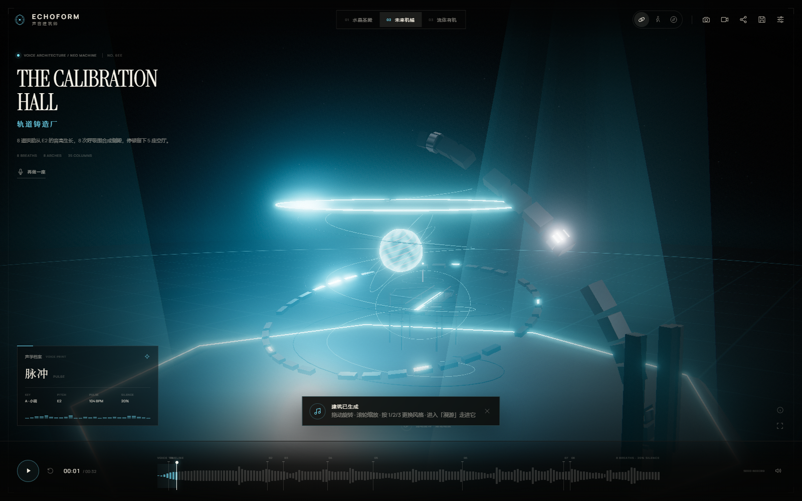 | 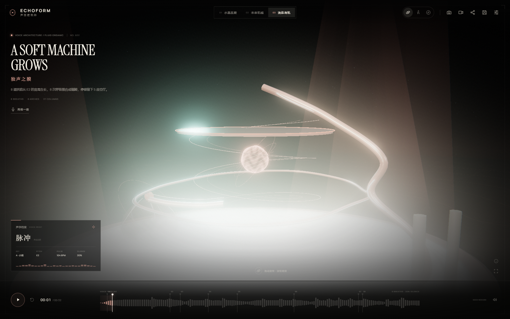 |
| 苍白石、玻璃、细密的纵向光柱；低音形成厚拱，高音形成针状尖顶。 | 石墨、拉丝金属、青色信号光；节奏驱动桁架与机械环，停顿留下冷却井。 | 骨质壳体、半透明膜、呼吸般的曲面；长音把拱拉成连续腔体，粒子像孢子一样悬浮。 |

---

## 演示

[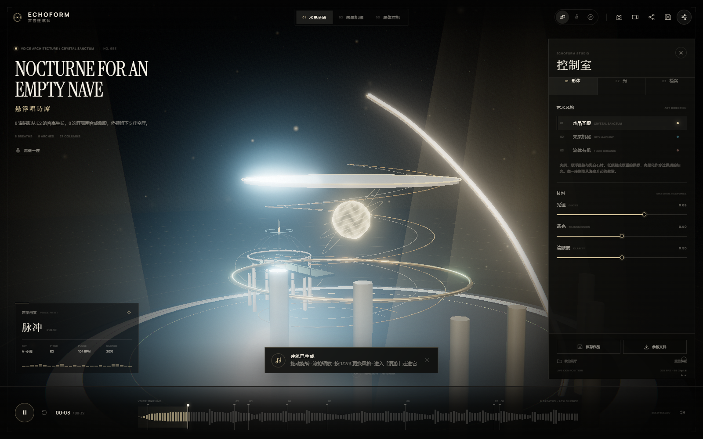](media/ECHOFORM-demo.mp4)

- **32 秒演示影像**：[`media/ECHOFORM-demo.mp4`](media/ECHOFORM-demo.mp4)（1280×720，H.264 + AAC，含原创声景）
- **2560×1440 海报**：[`media/poster.png`](media/poster.png)
- **精选截图**：[`media/screenshots/`](media/screenshots/)
- **原始示例声景**：运行时合成，源码见 [`src/lib/demo-audio.ts`](src/lib/demo-audio.ts)

---

## 2. 体验流程

### 01 · 序幕
黑色展厅，一束呼吸中的光核。没有仪表盘，没有“开始生成”的按钮堆叠；只有一句邀请：**让声音成为空间**。你可以直接说话、上传文件，或聆听一段 32 秒的原创示例声景。

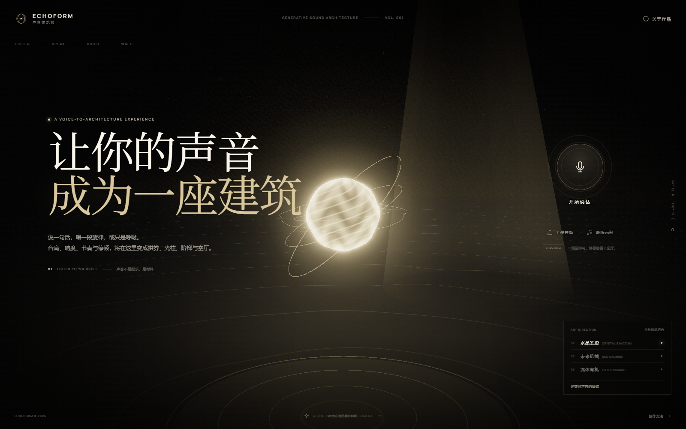

### 02 · 读取
声音先被拆开：FFT 频谱、响度包络、基频、起音、停顿、音色重心。屏幕上是一张正在被绘制的剖面图，而不是一个通用 loading 圈。

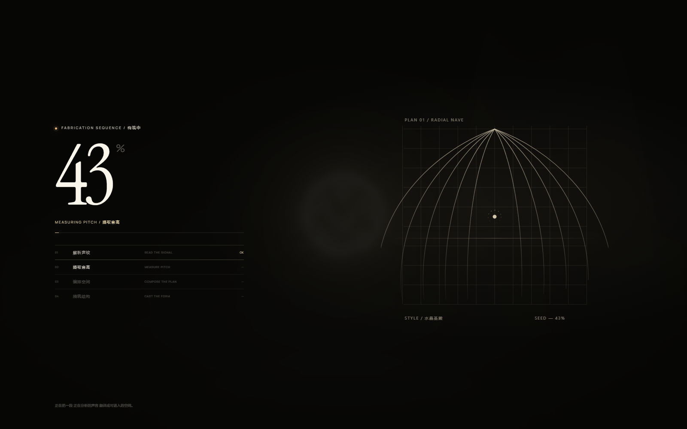

### 03 · 浇筑
拱肋从基频对应的尺度生长，侧殿按乐句的呼吸依次围合，柱列按高频能量刺入穹顶。声音还在播放，建筑仍在生长；时间轴可以拖动，建筑会回到那一刻的状态。


### 04 · 进入
- **轨道**：拖动旋转，滚轮/双指缩放。
- **漫游**：`W A S D` 移动，`Q / E` 下沉/上升，鼠标拖动视线；手机左下角摇杆。
- **导览**：镜头沿一条为这座建筑计算的路径缓慢穿过拱券与侧殿。
- `H` 隐藏界面，得到一张干净的建筑影像。
- 右侧控制室可实时调整光泽、透光、清晰度、曝光、辉光、色温与三盏灯；所有调整即时生效。

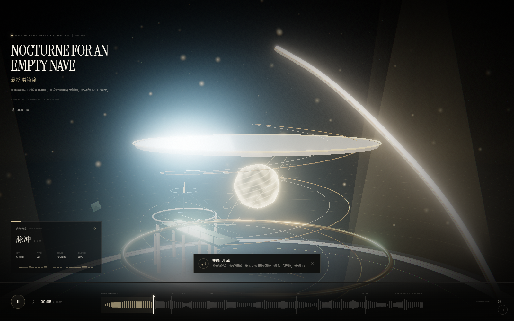

### 05 · 带走
海报、影像、参数文件、分享链接、本地展厅。分享链接只编码设计参数，不上传音频；打开链接的人会看到同一座建筑，但听到的是他们自己的静默版本。

### 06 · 移动端
同一套体验在手机上成立：底部抽屉控制室、循环镜头按钮、左下摇杆、可拖动时间轴。

| 序幕 | 建成 | 控制室 | 漫游 |
| --- | --- | --- | --- |
| 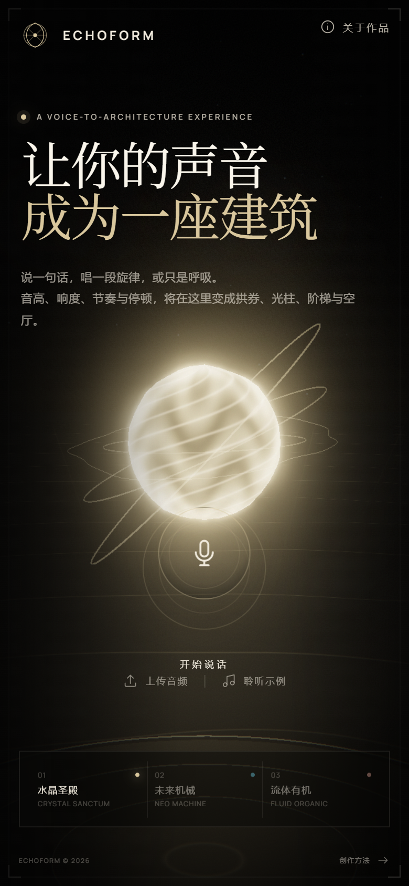 | 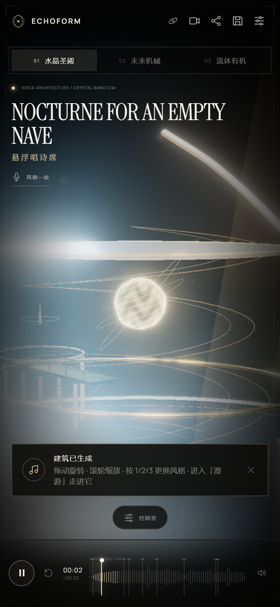 | 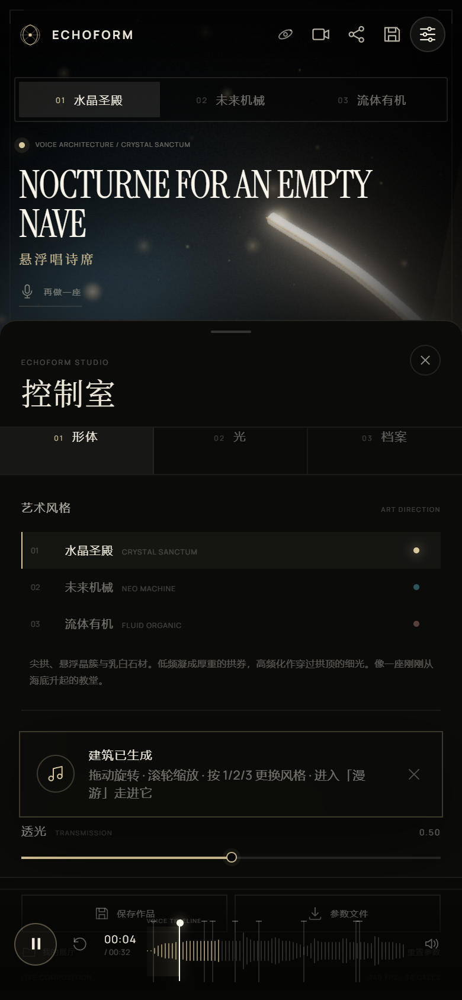 | 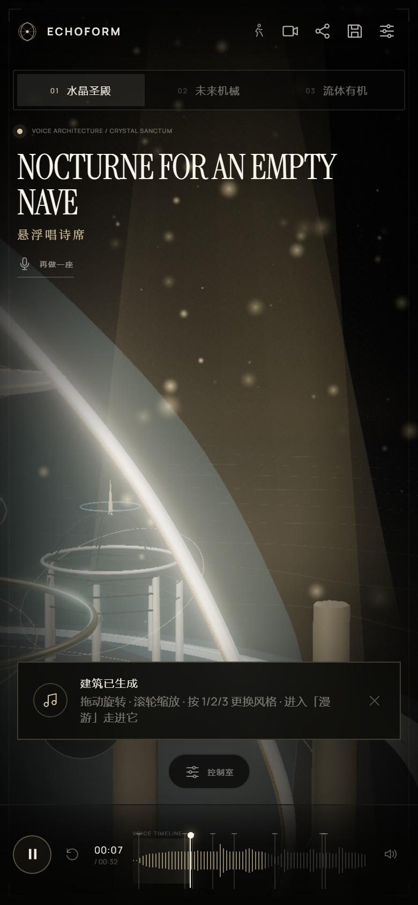 |

---

## 3. 声音如何变成建筑

ECHOFORM 不使用“随机摆一些柱子，然后让音乐亮一点”的做法。每一个建筑决定都能追溯到声音分析中的具体量。

| 声音特征 | 建筑/视觉映射 | 代码中的量 |
| --- | --- | --- |
| 基频 / 音高 | 建筑整体高度、拱肋高度、尖顶数量 | `pitchMedian`, `pitchNorm` → `height`, `spireCount` |
| 低频能量 | 拱券的厚度与进深、基座的重量感 | `summary.low` → `arch.depth`, `arch.width` |
| 高频能量 / 频谱重心 | 柱列数量与纤细程度、悬浮碎片、粒子密度 | `summary.high`, `brightness` → `columnCount`, `particleCount`, `shards` |
| 响度 / RMS | 整体尺度、开口宽度、光核强度 | `energy` → `scale`, `radius`, `core` |
| 节奏密度 / 起音 | 旋梯级数、模块重复、机械环的转速 | `onsetRate`, `density` → `stairSteps`, `ringCount`, `module` |
| 停顿 / 静默比 | 空厅、侧殿之间的距离、结构缺口 | `silenceRatio`, `phrase.pauseAfter` → `chamber.pauseAfter`, `gap` |
| 乐句 | 侧殿数量、拱的出生时间、时间轴标记 | `score.phrases` → `chambers`, `birth`, `phraseMarks` |
| 音色 / 温暖度 | 材质、透光、光色、粒子形态 | `warmth`, `centroid` → `palette`, `material`, `light` |
| 动态范围 | 光环层数、明暗对比 | `dynamicRange` → `ringCount`, `grade` |

几个具体的、可复核的例子（`tests/correlation.mjs` 的固定素材）：

- 110 Hz 纯低音：`low = 1.0`，`archDepth = 1.62`，建筑更低、更厚。
- 明亮锯齿波 220 Hz：`brightness = 0.72`，`columnCount = 34`，`particleCount = 2963`，柱林与悬浮粒子显著增加。
- 响度 0.8 vs 0.2 的 220 Hz：高度 `30.12` vs `20.4`，同一音高下，响度直接改变尺度。
- 4 个带停顿的乐句：`4` 个 `phraseMarks`、`4` 座侧殿、`4` 座空厅。
- 同一文件重复生成：指纹与全部几何参数逐位一致。

> 设计不是“把频谱画成 3D”。分析结果先被压缩成一份 `DesignSpec`：拱、殿、柱、环、碎片、旋梯、粒子、材质、光位、时间线。渲染器只负责把这份“建筑图纸”浇出来。

---

## 4. 确定性：同一段声音，同一座建筑

1. 音频在浏览器内解码，计算出一个内容指纹 `fingerprint`（FNV-1a 哈希，取自频谱/包络的量化摘要）。
2. 指纹 + 风格 + 中位音高派生种子，驱动 `mulberry32` 伪随机数。
3. 所有几何抖动、角度偏移、粒子分布都来自这个种子；没有 `Math.random()` 参与设计。
4. 时间轴、乐句、出生时间都写入 `DesignSpec`，因此刷新、分享、重放都得到同一座建筑。

这意味着：**它不是一次性的生成艺术，而是一件可以复现、可以比较、可以分享的作品。**

---

## 5. 技术栈

| 层 | 技术 |
| --- | --- |
| 应用 | React 19 + TypeScript 5.9 + Vite 8 |
| 3D | Three.js 0.186（WebGL2） |
| 后处理 | `EffectComposer` + `UnrealBloomPass` + 自定义 `GradeShader` + `OutputPass` |
| 音频分析 | 自研 FFT / STFT、峰值插值、自相关基频、起音与停顿检测 |
| 音频播放 | Web Audio API；示例声景由运行时 PCM 加法合成（不依赖外部音频服务） |
| 影像导出 | `canvas.captureStream()` + Web Audio `MediaStreamDestination` + `MediaRecorder`（优先 H.264 MP4） |
| 海报 | Canvas 2D 合成，PNG 输出 |
| 测试 | Playwright-core 驱动真实 Chrome，覆盖桌面、移动、音频、导出与性能 |

### 目录

```
src/
  App.tsx                 体验状态机、音频流程、导出与分享
  components/             Intro / Analysis / Workbench / Modals / Mobile
  lib/
    analysis.ts           FFT、音高、乐句、指纹
    design.ts             声音 → DesignSpec（拱/殿/柱/环/梯/粒子）
    demo-audio.ts         32 秒原创示例声景（PCM 合成 + 缓存）
    audio-engine.ts       播放、录音、实时分析
    poster.ts             海报合成
    video.ts              影像录制
    share.ts              参数链接编解码
    presets.ts            本地展厅
  three/
    engine.ts             场景、材质、灯光、相机、时间线、性能自适应
    shaders.ts            光核、地面、粒子、后处理
    builders.ts           程序化几何
  styles.css              视觉系统与响应式
tests/                    Playwright 验收与性能脚本
media/                    最终海报、影像、精选截图
docs/                     运行、部署、资产、性能、QA、文案
```

---

## 6. 运行

要求：Node.js ≥ 22.18（推荐 Node.js 24 LTS，以原生加载 TypeScript 配置），支持 WebGL2 的现代浏览器。

```bash
npm ci
npm run dev
# http://127.0.0.1:5178/
```

生产构建：

```bash
npm run build
npm run preview
# http://127.0.0.1:4178/
```

> 本项目没有后端。音频分析、建筑生成、录音、海报与影像导出全部在本地浏览器完成。

### 部署

构建产物在 `dist/`，可直接部署到任意静态托管：

- **Vercel / Netlify / Cloudflare Pages**：Build command `npm run build`，Output directory `dist`。
- **GitHub Pages**：已配置 `.github/workflows/pages.yml`。推送 `main` 自动安装依赖、构建、运行回归测试并发布。在仓库 Settings → Pages 中选择 GitHub Actions。`base: './'` 已兼容仓库子路径。
- **自托管 Nginx**：

```nginx
server {
  listen 80;
  server_name echoform.example;
  root /var/www/echoform/dist;
  index index.html;
  location / { try_files $uri $uri/ /index.html; }
  add_header Cross-Origin-Opener-Policy same-origin;
  add_header Cross-Origin-Embedder-Policy require-corp;
}
```

麦克风需要 **HTTPS** 或 `localhost`。若使用 COOP/COEP，确保字体与静态资源同源；本项目默认不依赖跨域资源。

---

## 7. 操作

| 操作 | 桌面 | 移动 |
| --- | --- | --- |
| 旋转视野 | 拖动 | 单指拖动 |
| 缩放 | 滚轮 | 双指捏合 |
| 漫游移动 | `W A S D` | 左下摇杆 |
| 上升 / 下沉 | `Q / E` | 摇杆推到底后上下拖动 |
| 切换镜头 | 顶栏 `轨道 / 漫游 / 导览` | 顶栏循环按钮 |
| 隐藏界面 | `H` | 双击画面 |
| 播放 / 暂停 | `Space` | 时间轴按钮 |
| 切换风格 | `1 / 2 / 3` | 风格标签 |
| 返回 / 关闭 | `Esc` | 关闭按钮 |

---

## 8. 性能

在 **NVIDIA RTX 4060 Ti / Chrome headless（真实 GPU）** 上测得：

| 场景 | 分辨率 | 平均 FPS | p95 帧时间 |
| --- | --- | --- | --- |
| 桌面 1440×900 | 1440 × 900 @ DPR 1 | 222 | 8.3 ms |
| 桌面 1080p | 1920 × 1080 @ DPR 1 | 220 | 8.4 ms |
| 桌面 2× | 1280 × 800 @ DPR 2 | 233 | 4.3 ms |
| 移动 1.6× | 390 × 844 @ DPR 1.6 | 236 | 4.3 ms |
| 压力 4K | 3840 × 2160 @ DPR 2 | 5.1 | 750 ms（自适应降至 1.5） |

策略：

- 几何全部程序化、按风格合并，单帧 draw call 约 70–243，三角形 3–11 万。
- Bloom 使用半分辨率链；透明材质按层排序，避免过度 overdraw。
- 设备像素比上限 2；帧时间持续超过预算 2.5 秒时自动把 DPR 降 0.5（只降一次，避免抖动）。
- 移动端默认使用“均衡”质量；可在控制室切换。

完整数据、压力测试与自适应验证见 [docs/PERFORMANCE.md](docs/PERFORMANCE.md)。

---

## 9. 隐私

- 麦克风与上传音频**只在浏览器内处理**，不上传服务器。
- 分享链接只包含 `DesignSpec` 的压缩参数，不包含音频。
- 本地展厅存储使用 `localStorage`，可随时在“控制室 → 我的展厅”删除。
- 导出影像与海报由浏览器本地生成。

---

## 10. 资产与许可

- 所有 3D 几何、材质、着色器、粒子、示例声景、海报模板与界面均为本项目原创，未使用第三方模型、HDRI、贴图或音频采样。
- 字体：**Instrument Serif**、**Manrope**（SIL Open Font License 1.1，通过 `@fontsource` 打包）；中文使用系统宋体 / Noto Serif CJK 回退，不随包分发。
- 运行时依赖：React（MIT）、Three.js（MIT）、Vite（MIT）等；完整清单与许可证见 [docs/ASSETS_LICENSES.md](docs/ASSETS_LICENSES.md)。
- 代码以 [MIT](LICENSE) 许可发布；品牌名、文案与视觉作品的使用请先联系作者。

---

## 11. 验收与测试

```bash
npm run test:regressions   # 禁用存储、分享参数校验、录音失败清理
npm run test:analysis      # 声音 → 建筑的相关性、确定性
npm run test:interactions  # 风格、滑杆、镜头、时间轴、HUD、存档
npm run test:capture       # 麦克风录制、文件导入、展厅
npm run test:sharing       # 海报、JSON、分享、MP4
npm run test:mobile        # 390×844 布局、面板、摇杆、触摸
npm run test:perf          # 桌面/移动/压力场景
```

原始验收结果与截图见 [docs/QA.md](docs/QA.md)，本轮修改见 [docs/OPTIMIZATION.md](docs/OPTIMIZATION.md)。验收脚本使用真实浏览器；回归脚本额外注入存储禁用与录音器构造失败，验证异常恢复。Windows 自动检测 Chrome / Edge；其他系统先运行 `npx playwright-core install --with-deps chromium`。可用 `CHROME_PATH` 和 `ECHOFORM_URL` 自定义浏览器和测试地址。

---

## 12. 团队 / 致谢

概念、设计、工程、声音与文案：**ECHOFORM Studio**。
初版程序化建筑建模与核心代码生成：**DeepSeek V4.1 Flash 1017**（`DeepSeek-V4.1-Flash-1017`）。
后续工程优化、浏览器验收与开源部署：Codex 协助完成。
特别感谢 Three.js、React、Vite 与开源字体社区。

如果这座建筑让你想起某个声音，欢迎把它带走。

**ECHOFORM — 声音建筑师**
